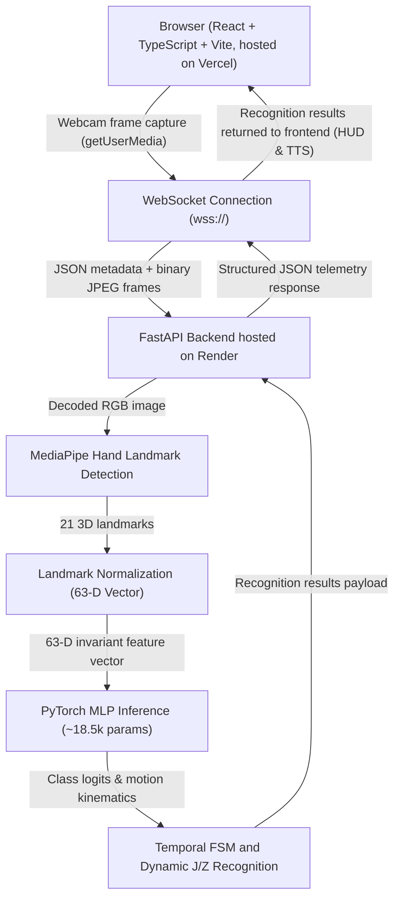

# Real-Time American Sign Language (ASL) Recognition & Speech Synthesis System

[](https://asl-gesture-studio.vercel.app)
[](https://asl-gesture-studio-backend.onrender.com/api/health)

[](https://www.python.org/downloads/release/python-31210/)
[%20%7C%202.15%2Bcpu%20(Cloud)-ee4c2c.svg)](https://pytorch.org/)
[](https://developers.google.com/mediapipe)
[](https://fastapi.tiangolo.com/)
[](https://react.dev/)
[](https://www.typescriptlang.org/)
[](https://www.docker.com/)
[-success.svg)](tests/)
[-success.svg)](frontend/src/test/)
[](LICENSE)

An end-to-end, production-oriented Computer Vision system that converts American Sign Language (ASL) fingerspelling and dynamic gestures into synthesized speech in real-time.

The project features both a **cloud-deployed production web studio** (React + TypeScript on Vercel paired with a containerized FastAPI backend on Render over WebSockets) and a **native desktop application** (OpenCV HUD with offline SAPI5 speech synthesis). The pipeline captures live webcam video, extracts 3D hand landmarks via MediaPipe, normalizes pose geometry into scale- and translation-invariant feature vectors, classifies static signs using a lightweight PyTorch MLP (~18.5k parameters; **0.155 ms** isolated local CPU forward-pass benchmark), detects dynamic strokes ('J' and 'Z') via kinematic temporal analysis, stabilizes emissions using a Finite State Machine (FSM), and speaks completed words asynchronously.

---

## Live Demo

Experience the full production system live in your browser:

| Service / Resource | Deployment Platform | Live URL / Endpoint | Status / Notes |
| :--- | :--- | :--- | :--- |
| **Live Web Application** | **Vercel** | [https://asl-gesture-studio.vercel.app](https://asl-gesture-studio.vercel.app) | Production Single-Page Application (SPA) |
| **Frontend Deployment** | **Vercel** | [https://asl-gesture-studio.vercel.app](https://asl-gesture-studio.vercel.app) | Production deployment linked to `main` branch |
| **Cloud Inference Backend** | **Render (Docker)** | [https://asl-gesture-studio-backend.onrender.com](https://asl-gesture-studio-backend.onrender.com) | Containerized FastAPI & PyTorch service |
| **Backend Health Endpoint** | **Render REST API** | [https://asl-gesture-studio-backend.onrender.com/api/health](https://asl-gesture-studio-backend.onrender.com/api/health) | Live telemetry: model status, detector status & sessions |

> [!NOTE]
> **Render Free Tier Spin-Down:** Render's free tier web services spin down after 15 minutes without inbound HTTP requests or WebSocket messages. Active webcam frame streaming sends regular inbound WebSocket messages and counts as traffic, keeping the service awake while actively in use. However, maintaining a connected but idle WebSocket without active frame transmissions does not keep the service awake once the 15-minute threshold is reached. Restarting the backend service after inactivity takes approximately one minute (~50–60 seconds). Once running, WebSocket recognition streams in real time. *(Note: Total cloud round-trip latency includes internet transit, WebSocket framing, and server-side image decoding in addition to the ~0.155 ms local CPU MLP forward pass).*

---

## Table of Contents

- [Live Demo](#live-demo)
- [Key Features](#key-features)
- [Production Deployment Architecture](#production-deployment-architecture)
  - [Architecture Flowchart](#architecture-flowchart)
  - [WebSocket Frame Streaming Protocol](#websocket-frame-streaming-protocol)
  - [End-to-End Processing Stages](#end-to-end-processing-stages)
- [Cloud Deployment](#cloud-deployment)
  - [Vercel Frontend](#vercel-frontend)
  - [Render Backend (Docker)](#render-backend-docker)
- [Running the Web Application Locally](#running-the-web-application-locally)
  - [Terminal 1: FastAPI Backend](#terminal-1-fastapi-backend)
  - [Terminal 2: React + Vite Frontend](#terminal-2-react--vite-frontend)
- [Running the Desktop Application (OpenCV HUD)](#running-the-desktop-application-opencv-hud)
  - [Launch Commands](#launch-commands)
  - [CLI Flags & Options](#cli-flags--options)
  - [Keyboard Controls & HUD Guide](#keyboard-controls--hud-guide)
- [Core Perception & ML Pipeline Architecture](#core-perception--ml-pipeline-architecture)
- [Project Directory Structure](#project-directory-structure)
- [Technology Stack](#technology-stack)
- [Installation & Desktop Environment Setup (Windows)](#installation--desktop-environment-setup-windows)
  - [Prerequisites](#prerequisites)
  - [Step 1: Clone Repository](#step-1-clone-repository)
  - [Step 2: Virtual Environment Setup](#step-2-virtual-environment-setup)
  - [Step 3: Dependency Installation](#step-3-dependency-installation)
- [Subsystems & Capabilities](#subsystems--capabilities)
  - [1. Static ASL Recognition (PyTorch MLP)](#1-static-asl-recognition-pytorch-mlp)
  - [2. Dynamic Gesture Recognition ('J' and 'Z')](#2-dynamic-gesture-recognition-j-and-z)
  - [3. Asynchronous Offline Text-to-Speech (TTS)](#3-asynchronous-offline-text-to-speech-tts)
  - [4. Robustness & Environmental Stress Evaluation](#4-robustness--environmental-stress-evaluation)
  - [5. Two-Hand Feature Representation (Feasibility Prototype)](#5-two-hand-feature-representation-feasibility-prototype)
- [Performance & Latency Profiling](#performance--latency-profiling)
- [Testing & Validation](#testing--validation)
  - [Test Suite Breakdown](#test-suite-breakdown)
- [Dataset Acquisition & Full Extraction](#dataset-acquisition--full-extraction)
- [Sign Language MNIST CNN Benchmark](#sign-language-mnist-cnn-benchmark)
- [Screenshots & UI Walkthrough](#screenshots--ui-walkthrough)
- [Limitations & Future Scope](#limitations--future-scope)
- [License](#license)

---

## Key Features

- **Production Cloud Deployment**: Zero-install web studio on Vercel backed by a containerized FastAPI microservice on Render over high-frequency WebSockets.
- **Real-Time 3D Landmark Tracking**: Tracks 21 hand landmarks (63 spatial coordinates) per frame at 40–55 FPS using MediaPipe Hand Landmarker.
- **Invariant Geometry Normalization**: Translation normalization (wrist origin), scale normalization (wrist-to-middle-MCP distance), and handedness canonicalization (left hands reflected onto right-hand coordinate frame).
- **Lightweight PyTorch MLP Classifier**: 3-layer architecture (63 &rarr; 128 &rarr; 64 &rarr; 28) with only 18,524 parameters, requiring **0.155 ms** isolated CPU forward pass per frame on local benchmark hardware.
- **Dynamic Gesture Recognition ('J' & 'Z')**: Kinematic trajectory buffer tracking fingertip motion vectors, curvature, and direction with zero static MLP interference.
- **Temporal Stabilization (FSM)**: Hysteresis state machine requiring sustained dwell (default 0.60s) and release debounce (0.25s) to eliminate jitter and duplicate letters.
- **Dual Speech Synthesis Modes**: Client-side Web Speech API in the browser studio and non-blocking offline `pyttsx3` worker thread in the desktop OpenCV application.
- **Multi-Session Cloud Isolation**: Independent state machines, smoothing queues, and text buffers per connected WebSocket client with automatic cleanup on disconnect.
- **Environmental Robustness Benchmark**: Reproducible synthetic stress framework evaluating lighting, Gaussian noise, motion blur, occlusions, scale, and tilt.
- **Multi-Hand Extension Framework**: 133-dimensional two-hand feature representation with explicit validity masks and inter-wrist relative geometry for future bimanual signs.

---

## Production Deployment Architecture

The deployed web system separates client-side video capture and UI rendering from high-performance server-side computer vision and neural network inference:

### Architecture Flowchart



### WebSocket Frame Streaming Protocol

As implemented in [`frontend/src/services/websocket.ts`](frontend/src/services/websocket.ts) and [`src/api/recognition_service.py`](src/api/recognition_service.py), the client and server communicate over a persistent full-duplex WebSocket (`/ws/recognition`) using a two-message interleaved protocol:

1. **Client Frame Transmission (Two-Message Interleaved Protocol):**
   - **Message 1 (Text / JSON):** The client sends a JSON text frame containing metadata:
     ```json
     {
       "type": "frame",
       "sequence_id": 1042,
       "capture_timestamp_ms": 1700000000123
     }
     ```
   - **Message 2 (Binary / ArrayBuffer):** Immediately following the metadata message, the client transmits raw binary JPEG image bytes as an `ArrayBuffer` (avoiding Base64 transmission overhead).
2. **Server Inference Response (`RecognitionResponse`):**
   - **Message (Text / JSON):** The backend decodes the binary JPEG bytes in memory, executes perception and inference, and returns structured recognition telemetry matching `RecognitionResponse`. *(Note: The `landmarks` array is abbreviated below for documentation purposes; an actual detected hand response contains all 21 normalized 3D landmarks)*:
     ```json
     {
       "type": "recognition_result",
       "sequence_id": 1042,
       "server_receive_timestamp_ms": 1700000000125,
       "processing_completion_timestamp_ms": 1700000000144,
       "processing_duration_ms": 18.7,
       "hand_detected": true,
       "handedness": "Right",
       "landmark_valid": true,
       "landmarks": [
         { "x": 0.512, "y": 0.621, "z": -0.015 }
       ],
       "raw_prediction": "A",
       "raw_confidence": 0.945,
       "smoothed_prediction": "A",
       "smoothed_confidence": 0.938,
       "confidence_gate_passed": true,
       "top_predictions": [
         { "label": "A", "confidence": 0.938 },
         { "label": "E", "confidence": 0.031 },
         { "label": "S", "confidence": 0.015 }
       ],
       "static_fallback_label": null,
       "dynamic_candidate": null,
       "confirmed_dynamic_result": null,
       "fsm_candidate": "A",
       "fsm_is_dwelling": true,
       "fsm_dwell_time": 0.39,
       "dwell_progress": 0.65,
       "committed_label": null,
       "text_buffer": "HELLO ",
       "speech_token": null,
       "error_status": null
     }
     ```
3. **Client Control Messages (`ClientControlMessage`):**
   - Standalone JSON text messages dispatched on user button clicks or keyboard shortcuts:
     ```json
     { "type": "init", "speech_enabled": false }
     { "type": "space" }
     { "type": "delete" }
     { "type": "clear" }
     { "type": "speech_pref", "speech_enabled": true }
     ```

### End-to-End Processing Stages

1. **Browser Video Capture (`getUserMedia`)**: The React application requests webcam access and binds the live stream to an HTML5 `<video>` element. Frames are periodically drawn to an offscreen canvas and compressed to JPEG bytes.
2. **WebSocket Streaming**: Frame metadata (`sequence_id`, `capture_timestamp_ms`) followed immediately by raw binary JPEG bytes (`ArrayBuffer`) are dispatched over `wss://asl-gesture-studio-backend.onrender.com/ws/recognition`.
3. **MediaPipe Landmark Detection**: On Render, FastAPI decodes the binary JPEG bytes into an OpenCV RGB image matrix. MediaPipe Hand Landmarker extracts 21 3D hand coordinates ($x, y, z$). If no hand is present, dwell progression resets immediately.
4. **Landmark Normalization**: Raw coordinates are translated to place the wrist at $(0,0,0)$, scaled by wrist-to-middle-MCP Euclidean distance, and canonicalized (left hands mirrored onto right-hand coordinate frame) to produce a 63-D invariant feature vector.
5. **PyTorch MLP Inference**: The normalized 63-D vector is passed through `ASLLandmarkMLP` (18,524 parameters), calculating softmax probabilities across 28 classes (**0.155 ms** isolated local CPU inference benchmark; total cloud request latency additionally incorporates network transit, WebSocket transport, and frame decoding).
6. **Temporal FSM & Dynamic J/Z Recognition**: Index and pinky finger coordinates update a 35-frame temporal buffer to detect 'J' and 'Z' kinematic strokes. The session's Finite State Machine confirms a 0.60s sustained dwell hold and 0.25s release debounce before committing letters.
7. **Frontend Rendering & Audio Feedback**: Recognition results return over the WebSocket. The frontend renders the 21-point skeleton on the canvas overlay, updates live dwell indicators, manages the sentence buffer, and synthesizes audio via the browser's Web Speech API.

---

## Cloud Deployment

### Vercel Frontend

The web user interface is deployed as a static single-page application on Vercel's global CDN:

- **Root Directory:** `frontend`
- **Framework:** Vite
- **Build Command:** `npm run build` (`tsc -b && vite build`)
- **Output Directory:** `dist`
- **Node.js Runtime:** 20.x / 22.x
- **Branch Integration:** Connected to the GitHub repository `main` branch with root directory `frontend` and output directory `dist`.
- **Environment Variables:**
  | Variable | Value | Description |
  | :--- | :--- | :--- |
  | `VITE_API_BASE_URL` | `https://asl-gesture-studio-backend.onrender.com` | Base URL for REST endpoints (`/api/health`, `/api/system/info`) |
  | `VITE_WS_BASE_URL` | `wss://asl-gesture-studio-backend.onrender.com` | Secure WebSocket endpoint for live recognition stream |

### Render Backend (Docker)

The Python backend is containerized and hosted as a Web Service on Render:

- **Runtime:** Docker
- **Dockerfile:** `./Dockerfile` (located at repository root)
- **Base Image:** `python:3.12-slim`
- **System Dependencies:** `libgl1`, `libegl1`, `libgles2`, `libglib2.0-0`, `libgomp1`, and `curl` (ensures headless OpenCV and MediaPipe Linux C-bindings initialize reliably without GUI desktop packages)
- **Python Dependencies:** `requirements-backend.txt` (CPU-optimized PyTorch `2.15.0+cpu`, MediaPipe `1.0.1`, headless OpenCV, FastAPI, Uvicorn, WebSockets)
- **Embedded Assets:** Pre-packaged inside the Docker image:
  - Trained PyTorch model weights: `models/asl_landmark_mlp_best.pt`
  - MediaPipe task bundle: `hand_landmarker.task`
- **Health Check Path:** `/api/health` (Polled periodically by Render to monitor container health and readiness)
- **Port Configuration:** Automatically binds to the `$PORT` environment variable assigned dynamically by the Render runtime (defaults to `8000`).
- **Deployment Configuration:** Linked to the GitHub repository `main` branch with Dockerfile build context at repository root.

> [!WARNING]
> **Free Instance Spin-Down:** Render's free tier web services spin down after 15 minutes without inbound HTTP requests or WebSocket messages. While active webcam frame streaming continuously sends inbound WebSocket messages that count as traffic, maintaining an open but idle WebSocket connection without active frame transmissions will not keep the service awake. Restarting the backend service after an idle spin-down takes approximately one minute (~50–60 seconds).

---

## Running the Web Application Locally

To run the complete web studio locally with live hot-reloading, run the backend and frontend in separate terminals:

### Terminal 1: FastAPI Backend

1. Activate your virtual environment:
   ```powershell
   # Windows PowerShell
   .\.venv\Scripts\Activate.ps1

   # Linux / macOS
   source .venv/bin/activate
   ```

2. Install backend dependencies:
   ```powershell
   pip install -r requirements-backend.txt
   ```

3. Start the FastAPI development server with Uvicorn:
   ```powershell
   uvicorn src.api.main:app --host 127.0.0.1 --port 8000 --reload
   ```

4. Verify local backend endpoints:
   - **Interactive API Documentation (Swagger UI):** [http://127.0.0.1:8000/docs](http://127.0.0.1:8000/docs)
   - **Health Check Endpoint:** [http://127.0.0.1:8000/api/health](http://127.0.0.1:8000/api/health)
   - **System Info Endpoint:** [http://127.0.0.1:8000/api/system/info](http://127.0.0.1:8000/api/system/info)
   - **WebSocket Recognition Endpoint:** `ws://127.0.0.1:8000/ws/recognition`

   *(Note: The root path `/` is reserved for serving the built frontend SPA in combined deployments and returns `{"detail":"Not Found"}` when running the API server standalone; use `/docs` or `/api/health` to verify service operation).*

### Terminal 2: React + Vite Frontend

1. Navigate to the frontend directory:
   ```powershell
   cd frontend
   ```

2. Install Node dependencies:
   ```powershell
   npm install
   ```

3. Start the Vite local development server:
   ```powershell
   npm run dev
   ```

4. Open the application in your browser:
   - **Local Web Application URL:** [http://localhost:5173](http://localhost:5173)

*Note: The local Vite environment automatically proxies API and WebSocket requests to `http://127.0.0.1:8000` via its default `.env` configuration.*

---

## Running the Desktop Application (OpenCV HUD)

In addition to the web studio, the repository includes a native desktop application with an OpenCV Heads-Up Display (HUD) and offline text-to-speech.

### Launch Commands

Start the real-time desktop application with all features enabled (static alphabet, dynamic J/Z, and speech):
```powershell
python src/realtime/app.py
```

### CLI Flags & Options

| Flag | Default | Description |
| :--- | :---: | :--- |
| `--camera` | `0` | System webcam device ID / camera index (e.g. `0`, `1`). |
| `--dwell` | `0.60` | Sustained dwell duration in seconds required to commit a letter. |
| `--release` | `0.25` | Sustained absence required to re-arm the same letter. |
| `--min-conf` | `0.70` | Minimum softmax confidence threshold. |
| `--no-dynamic` | `False` | Disables dynamic J/Z gesture recognition. |
| `--no-speech` | `False` | Disables text-to-speech audio synthesis. |
| `--enable-geometric` | `False` | Enables fine-grained anatomical geometric disambiguation rules. |
| `--no-mirror` | `False` | Disables horizontal mirroring of webcam display. |
| `--diagnostics` | `False` | Enables frame-by-frame telemetry logging to CSV. |
| `--max-frames` | `None` | Optional limit on processed frames (useful for headless testing). |

### Keyboard Controls & HUD Guide

- **`V`**: Toggle Text-to-Speech **ON / OFF** in real time.
- **`SPACE`**: Complete current word, append space, and trigger speech for the finished word.
- **`BACKSPACE` / `DELETE`**: Remove the last character from the text buffer.
- **`C`**: Clear entire text buffer.
- **`Q` or `ESC`**: Gracefully shut down application, release camera, and terminate background threads.

---

## Core Perception & ML Pipeline Architecture

The underlying computer vision and machine learning pipeline is shared across both desktop and cloud web architectures:

```
[Webcam Stream]
      │
      ▼
[Frame Acquisition / Mirroring]
      │
      ▼
[MediaPipe Hand Landmarker] (Extracts 21 3D landmarks @ ~20ms)
      │
      ├───► [Temporal Sequence Buffer] (Tracks 35-frame pinky/index trajectories)
      │         │
      │         ▼
      │     [Kinematic Dynamic Classifier] ──► Qualified 'J' or 'Z' Stroke Detected?
      │         │                                      │
      ▼         ▼                                      │ (Bypasses static dwell)
[LandmarkNormalizer]                                   │
  ├── Wrist Translation (origin at (0,0,0))            │
  ├── Scale Normalization (wrist-to-middle-MCP)        │
  └── Handedness Canonicalization (Left -> Right)      │
      │                                                │
      ▼                                                │
[PyTorch ASLLandmarkMLP] (63-D -> 28 classes)          │
      │                                                │
      ▼                                                │
[Confidence & Ambiguity Gate]                          │
      │                                                │
      ▼                                                │
[GestureStateMachine (FSM)] ◄──────────────────────────┘
  ├── Dwell Confirmation (0.60s sustained hold)
  └── Release Hysteresis (0.25s debounce before re-arming)
      │
      ▼
[TextBuffer] (Appends chars, handles SPACE / DELETE, avoids double spaces)
      │
      ├───► [Speech Engine (TTS)] (Speaks on SPACE or 2.5s conversational pause)
      │
      ▼
[Visual Display Output] (Web Canvas HUD or Desktop OpenCV Window)
```

---

## Project Directory Structure

```text
ASL-Gesture-Recognition/
├── Dockerfile                      # Production container specification for Render
├── render.yaml                     # Render Infrastructure-as-Code deployment blueprint
├── requirements.txt                # Full dependencies for CUDA GPU environments
├── requirements-cpu.txt            # Desktop CPU-only dependencies
├── requirements-backend.txt        # Production cloud container dependencies (CPU PyTorch + FastAPI)
├── hand_landmarker.task            # MediaPipe Hand Landmarker model bundle (7.46 MB)
├── docs/
│   └── FINAL_TECHNICAL_REPORT.md   # Complete architectural and empirical research report
├── frontend/                       # Production React + TypeScript + Vite web application
│   ├── .env.production             # Production environment variables (Render endpoints)
│   ├── index.html                  # HTML5 application shell
│   ├── package.json                # Frontend package dependencies & scripts
│   ├── vite.config.ts              # Vite build configuration
│   └── src/
│       ├── App.tsx                 # Root studio interface & tab routing
│       ├── components/
│       │   ├── brand/
│       │   │   └── Logo.tsx
│       │   ├── layout/
│       │   │   └── Navbar.tsx      # Navigation header & live health indicator
│       │   ├── recognition/
│       │   │   └── RecognitionPanel.tsx # Live prediction, confidence & dwell meters
│       │   ├── text-buffer/
│       │   │   └── TextBufferPanel.tsx  # Word/sentence buffer & editing controls
│       │   └── webcam/
│       │       └── WebcamPanel.tsx      # Video canvas, landmark skeleton overlay
│       ├── context/
│       │   └── CameraStatusContext.tsx  # Camera lifecycle state provider
│       ├── hooks/
│       │   ├── useRecognition.ts   # Recognition telemetry state & controls
│       │   ├── useWebcam.ts        # MediaDevices camera lifecycle & frame loop
│       │   └── useWebSocket.ts     # Resilient WebSocket connection & frame dispatch
│       ├── pages/
│       │   ├── Dashboard.tsx       # System overview & telemetry metrics
│       │   ├── DevStates.tsx       # Component state preview harness
│       │   ├── Diagnostics.tsx     # Health checks & system info viewer
│       │   ├── LiveTranslator.tsx  # Main interactive ASL recognition studio
│       │   ├── ModelInsights.tsx   # Model architecture & benchmark visualization
│       │   └── NotFound.tsx        # 404 error page
│       ├── services/
│       │   ├── api.ts              # REST client for /api/health and /api/system/info
│       │   └── websocket.ts        # Two-message binary WebSocket transport
│       ├── test/                   # Vitest unit & integration tests (26 passed)
│       │   ├── apiHealth.test.ts
│       │   ├── components.test.tsx
│       │   ├── landmarkRenderer.test.ts
│       │   ├── sequenceId.test.ts
│       │   ├── setup.ts
│       │   ├── textBuffer.test.ts
│       │   └── websocket.test.ts
│       ├── types/
│       │   └── api.ts              # TypeScript schemas for REST & WebSocket contracts
│       └── utils/
│           ├── frameCapture.ts     # Canvas offscreen JPEG encoder
│           └── landmarkRenderer.ts # 21-landmark 2D canvas drawing utility
├── models/
│   ├── asl_landmark_mlp_best.pt    # Trained PyTorch 28-class MLP weights (18,524 params)
│   └── mnist_cnn_best.pt           # Benchmark Sign Language MNIST CNN weights
├── reports/
│   └── robustness/                 # Environmental stress and profiling JSON/MD reports
├── scripts/
│   ├── evaluate_robustness.py      # Reproducible robustness and latency profiling tool
│   ├── train_mlp.py                # MLP training script for ASL Alphabet
│   └── audit_live_diagnostics.py   # Diagnostics verification and telemetry audit
├── src/
│   ├── api/                        # FastAPI cloud backend & WebSocket server
│   │   ├── lifespan.py             # Server startup/shutdown & model pre-loading
│   │   ├── main.py                 # FastAPI application factory, CORS, routes
│   │   ├── model_service.py        # Shared PyTorch MLP and MediaPipe inference service
│   │   ├── recognition_service.py  # Binary WebSocket frame decoding & pipeline dispatch
│   │   ├── schemas.py              # Pydantic v2 request/response contracts
│   │   └── session_manager.py      # Multi-user session isolation & state management
│   ├── benchmark/                  # Sign Language MNIST CNN baseline module
│   ├── landmarks/
│   │   ├── geometric_disambiguator.py # Invariant anatomical geometric rules (optional)
│   │   ├── labels.py               # 28 semantic class mappings (A-Z, SPACE, DELETE)
│   │   ├── normalizer.py           # Single-hand 63-D invariant normalization
│   │   └── two_hand.py             # Two-hand 133-D feature representation & prototype
│   ├── model/
│   │   └── mlp.py                  # PyTorch ASLLandmarkMLP neural network definition
│   └── realtime/
│       ├── app.py                  # Main real-time OpenCV desktop application
│       ├── gesture_state_machine.py# Temporal FSM for dwell confirmation & debounce
│       ├── inference.py            # PyTorch inference wrapper with class probabilities
│       ├── speech.py               # Asynchronous offline TTS engine (pyttsx3)
│       ├── temporal_sequence.py    # Kinematic trajectory buffer & J/Z dynamic classifier
│       └── text_buffer.py          # Word construction and editing buffer
├── tests/                          # Automated backend test suite (183 passed)
│   ├── test_api_backend.py         # End-to-end FastAPI, WebSocket, and session isolation tests
│   ├── test_dynamic_gestures.py    # Unit tests for J/Z trajectories and kinematics
│   ├── test_geometric_disambiguation.py # Geometric rule validation and dynamic Z tests
│   ├── test_mlp.py                 # PyTorch model architecture tests
│   ├── test_normalizer.py          # Geometric invariance unit tests
│   ├── test_optimization_stability.py # Moving average smoothing & stability tests
│   ├── test_realtime_inference.py  # Inference engine and probability tests
│   ├── test_realtime_pipeline.py   # Integrated pipeline execution tests
│   ├── test_realtime_state_machine.py # FSM dwell and hysteresis timing tests
│   ├── test_robustness.py          # Robustness transformations and metric tests
│   ├── test_speech.py              # Asynchronous TTS queue and worker tests
│   ├── test_text_buffer.py         # Text assembly and backspacing tests
│   └── test_two_hand.py            # Two-hand extraction, mask, and prototype tests
├── pytest.ini                      # Pytest discovery configuration
└── README.md                       # Main project documentation
```

---

## Technology Stack

### Cloud & DevOps
- **Containerization:** Docker (`python:3.12-slim` minimal Debian runtime)
- **Backend Hosting:** Render Web Service (Docker runtime from repository `Dockerfile`, health monitored at `/api/health`)
- **Frontend Hosting:** Vercel (Edge network, global CDN, linked to `main` branch)
- **Infrastructure as Code:** `render.yaml`, `Dockerfile`, `.dockerignore`

### Web Frontend
- **Framework:** React 19 (`react==19.3.1`, `react-dom==19.3.1`)
- **Language & Tooling:** TypeScript (`~7.0.2`), Vite 8 (`vite==8.3.6`)
- **Styling & Design System:** Tailwind CSS v4 (`@tailwindcss/vite==4.3.5`), Lucide React icons (`lucide-react==1.73.0`)
- **Animation & Transitions:** Framer Motion (`framer-motion==14.14.0`)
- **Client-Side Speech:** Web Speech API (`window.speechSynthesis`)

### Web Backend & Streaming API
- **Framework:** FastAPI (`fastapi>=0.100.0`), ASGI Server: Uvicorn (`uvicorn[standard]>=0.23.0`)
- **Streaming Transport:** WebSockets (`websockets>=11.0`, full-duplex binary JPEG ArrayBuffer + JSON metadata)
- **Data Validation & Schemas:** Pydantic v2 (`pydantic>=2.0.0`)
- **CORS Protection:** `fastapi.middleware.cors.CORSMiddleware` (Configured for `https://asl-gesture-studio.vercel.app` and local dev origins)

### Machine Learning, Computer Vision & Speech
- **Hand Perception:** MediaPipe (`mediapipe==1.0.1`, Hand Landmarker with 21 3D points)
- **Image Processing:** OpenCV (`opencv-python==5.0.0.93` for desktop GUI; `opencv-python-headless>=4.8.0` for headless cloud container)
- **PyTorch (Desktop Environment):** PyTorch `2.14.0+cu132` (or CPU mode) with optional NVIDIA GPU acceleration via `requirements.txt` / `requirements-cpu.txt`
- **PyTorch (Cloud Production Backend):** CPU-optimized PyTorch `2.15.0+cpu` (`torch>=2.0.0` from PyTorch CPU wheel index in `requirements-backend.txt`) to minimize container image footprint and eliminate CUDA runtime overhead in headless Linux environments.
- **Neural Network Architecture:** `ASLLandmarkMLP` (3 layers, 18,524 parameters, 28 output classes)
- **Kinematic Analysis:** NumPy (`2.5.2`), SciPy (`1.18.1`), scikit-learn (`1.9.1`)
- **Desktop Audio:** `pyttsx3>=2.90` (Offline SAPI5 on Windows), `comtypes`

### Testing & Quality Assurance
- **Backend Test Suite:** Pytest (`pytest==9.1.1`, 183 automated tests, 100% passing)
- **Frontend Unit Testing:** Vitest (`vitest==5.1.0`), Testing Library (`@testing-library/react==16.3.3`, `@testing-library/jest-dom==7.0.1`)
- **Code Quality & Linting:** Oxlint (`oxlint==1.90.0`), TypeScript Compiler (`tsc ~7.0.2`)

---

## Installation & Desktop Environment Setup (Windows)

### Prerequisites

- Windows 10/11 (64-bit)
- Python 3.12.10 installed and added to system `PATH`
- Working webcam and audio speakers/headphones

### Step 1: Clone Repository

```powershell
git clone https://github.com/Gaurav-Ojha65/ASL-Gesture-Recognition.git
cd ASL-Gesture-Recognition
```

### Step 2: Virtual Environment Setup

```powershell
python -m venv .venv
.\.venv\Scripts\Activate.ps1
```

### Step 3: Dependency Installation

For standard CPU execution (recommended):
```powershell
pip install -r requirements-cpu.txt
```

For NVIDIA GPU / CUDA 13.2 execution:
```powershell
pip install -r requirements.txt
```

---

## Subsystems & Capabilities

### 1. Static ASL Recognition (PyTorch MLP)
- Recognizes 26 uppercase alphabet letters (A–Z) plus control gestures `SPACE` and `DELETE`.
- Trained on 87,000+ hand landmark vectors with translation and scale invariance.
- Runs with **0.155 ms** CPU forward-pass latency on local benchmark hardware.

### 2. Dynamic Gesture Recognition ('J' and 'Z')
- **Letter J:** Recognizes the physical curved stroke performed with the extended pinky finger.
- **Letter Z:** Recognizes the three-stroke zig-zag motion performed with the extended index finger.
- Incorporates a 1.2-second cooldown to prevent duplicate triggers.
- Automatically remaps stationary MLP predictions for J &rarr; I and Z &rarr; D, eliminating false static commits.

### 3. Asynchronous Offline Text-to-Speech (TTS)
- Completely non-blocking: Enqueue overhead on the camera thread is only **0.025 ms**.
- **Word Completion:** Automatically speaks the completed word when `SPACE` is committed.
- **Conversational Pause:** Speaks buffered words after a configurable 2.5-second pause.
- Duplicate suppression prevents repeated utterances within a 4.0-second window.

### 4. Robustness & Environmental Stress Evaluation
Run the reproducible evaluation script:
```powershell
python scripts/evaluate_robustness.py
```
Outputs performance benchmarks and environmental stress tests across brightness, noise, motion blur, and occlusions to `reports/robustness/`.

### 5. Two-Hand Feature Representation (Feasibility Prototype)
Implemented in [`src/landmarks/two_hand.py`](src/landmarks/two_hand.py):
- Extracts up to two hands with deterministic Left/Right sorting.
- Produces a **133-dimensional** vector (63 left + 63 right + 5 inter-hand spatial + 2 validity masks).
- Feature normalization takes **0.028 ms** on CPU.
- *Status:* Architectural foundation and heuristic prototype; ready for future multi-hand trained models.

---

## Performance & Latency Profiling

Benchmarked on **Intel Core i7-12700H (12 Cores, Windows 11, PyTorch CPU mode)**:

| Pipeline Component | Mean Latency (ms) | Median (ms) | P95 (ms) | Real-Time Budget Share |
| :--- | :---: | :---: | :---: | :---: |
| **MediaPipe Landmark Tracking** | 18.50 ms | 18.20 ms | 22.10 ms | ~98.0% |
| **Landmark Normalization (63-D)** | 0.012 ms | 0.012 ms | 0.012 ms | <0.1% |
| **PyTorch MLP Inference (28 cls)** | 0.155 ms | 0.099 ms | 0.327 ms | ~0.8% |
| **Dynamic Trajectory Classifier (J/Z)**| 0.035 ms | 0.032 ms | 0.052 ms | ~0.2% |
| **Temporal FSM & Text Buffer** | 0.001 ms | 0.001 ms | 0.001 ms | <0.01% |
| **Total Post-Perception Processing** | **0.203 ms** | **0.144 ms** | **0.392 ms** | **<1.0%** |
| **TTS Queue Latency (Main Thread)** | **0.025 ms** | **0.014 ms** | **0.085 ms** | Non-blocking |

---

## Testing & Validation

Execute the automated test suites across both backend and frontend layers:

```powershell
# Run Python backend test suite (183 tests)
python -m pytest tests -v

# Run React frontend test suite (26 tests)
npm --prefix frontend test
```

### Test Suite Breakdown

| Test Suite | Framework | Scope / Coverage | Tests Passed | Status |
| :--- | :--- | :--- | :---: | :---: |
| **Backend Test Suite** | **Pytest** (`pytest==9.1.1`) | Normalization, PyTorch MLP, FSM dwell/release, dynamic J/Z kinematics, offline speech synthesis, FastAPI REST & WebSocket endpoints, multi-session isolation | **183 passed** |  |
| **Frontend Test Suite** | **Vitest** (`vitest==5.1.0`) | WebSocket client transport, sequence ID monotonicity, text buffer manipulation, API health service, landmark canvas rendering, UI components | **26 passed** |  |
| **Total Automated Tests** | Combined | Full-stack unit, integration, and regression coverage | **209 passed** | **100% Passing** |

---

## Dataset Acquisition & Full Extraction

Datasets are excluded from Git to keep the repository lightweight. If you wish to reproduce landmark extraction and train the MLP from scratch:

1. **ASL Alphabet Dataset (Kaggle):**
   - Download the raw dataset: [Kaggle ASL Alphabet](https://www.kaggle.com/datasets/grassknoted/asl-alphabet)
   - Extract raw images to:
     ```
     data/raw/asl_alphabet/asl_alphabet_train/
     ```
2. **Execute Full Landmark Extraction:**
   ```powershell
   python full_extraction.py
   ```
   *Extracts 21 3D landmarks for 87,000 images, normalizes coordinates, and writes train/val/test splits to Parquet files under `data/processed/landmarks/full/`.*

3. **Train the PyTorch MLP:**
   ```powershell
   python scripts/train_mlp.py
   ```

---

## Sign Language MNIST CNN Benchmark

An isolated 2D CNN module is included for evaluating pixel-based classification on the 28x28 grayscale Sign Language MNIST benchmark:

1. **Dataset Setup:**
   - Download CSVs from: [Sign Language MNIST](https://www.kaggle.com/datasets/datamunge/sign-language-mnist)
   - Place files in: `data/raw/sign_language_mnist/`
2. **Train the Benchmark CNN:**
   ```powershell
   python src/benchmark/train.py
   ```
3. **Evaluate the Benchmark CNN:**
   ```powershell
   python src/benchmark/evaluate.py
   ```

---

## Screenshots & UI Walkthrough

*(Run the application locally to observe live feed with HUD overlay)*

```
+-----------------------------------------------------------+
| Real-Time ASL Recognition HUD                 FPS: 45.2   |
| Speech: [ON] (Press 'V' to toggle)                        |
|                                                           |
|                 [Hand Skeleton Overlay]                   |
|                      o---o---o                            |
|                     /                                     |
|                                                           |
| Top Prediction: [L]  (94.2%)                              |
| Dwell Progress: [===============>      ] 72%              |
|                                                           |
| Committed Text: HELLO WORLD_                              |
+-----------------------------------------------------------+
```

---

## Limitations & Future Scope

### Current Limitations
1. **Static MLP Trained on Single Hands:** The current MLP operates strictly on 63-dimensional single-hand landmarks. Two-handed signs require a dedicated multi-hand model.
2. **Heuristic J/Z Dynamic Recognition:** Stroke classification for 'J' and 'Z' uses explainable geometric kinematic rules rather than a deep sequence model (e.g. LSTM/GRU).
3. **Lighting & Contrast Sensitivity:** Hand landmark accuracy degrades under severe underexposure (<15 lux) or excessive backlight.

### Future Scope
1. **Sequence Deep Learning:** Train an LSTM or Temporal Convolutional Network (TCN) on continuous signing videos.
2. **WLASL Two-Hand Integration:** Train a dedicated two-hand model on the 133-D feature representation using the WLASL dataset.
3. **Word Autocompletion & LLM Correction:** Integrate n-gram language models to correct typos and expand signed abbreviations into natural sentences.

---

## License

This project is licensed under the Apache 2.0 License — see the [LICENSE](LICENSE) file for details.
