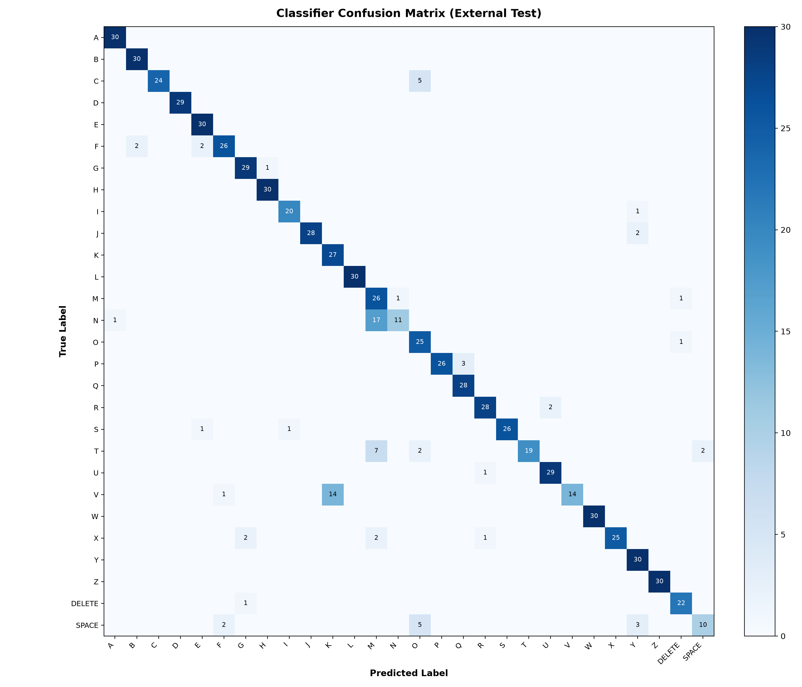
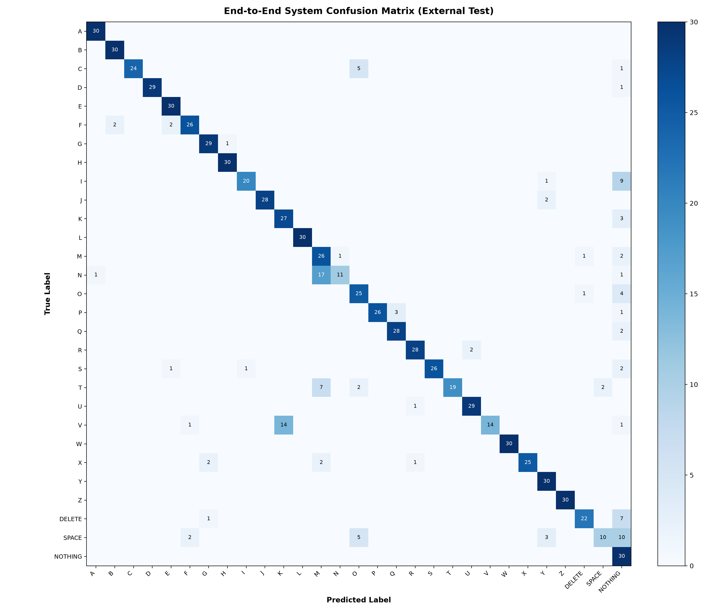

# ASL External Dataset Evaluation Report

**Model Checkpoint:** `models/asl_landmark_mlp_best.pt` (Best Epoch: 22, Frozen)
**Evaluation Date:** 2026-10-16 14:35:36

> [!IMPORTANT]
> **Denominator Distinction:**
> - **Classifier-Only Metrics:** Evaluated **strictly** on the successfully extracted hand-bearing external images.
>   *(Denominator: 796 samples across 28 classes)*.
> - **End-to-End System Metrics:** Evaluated on all 870 images, where missing a hand-bearing gesture is counted as a pipeline error (predicting NOTHING).
>   *(Denominator: 870 total images across 29 classes)*.

## 1. Classifier-Only Performance (28 Classes)
- **Evaluated Support:** 796 / 840 hand-bearing images
- **Accuracy:** **0.8945** (89.45%)
- **Macro Precision:** **0.9158** (91.58%)
- **Macro Recall:** **0.8910** (89.10%)
- **Macro F1:** **0.8875** (88.75%)
- **Weighted F1:** **0.8912** (89.12%)

### Per-Class Performance Table
```text
              precision    recall  f1-score   support

           A       0.97      1.00      0.98        30
           B       0.94      1.00      0.97        30
           C       1.00      0.83      0.91        29
           D       1.00      1.00      1.00        29
           E       0.91      1.00      0.95        30
           F       0.90      0.87      0.88        30
           G       0.91      0.97      0.94        30
           H       0.97      1.00      0.98        30
           I       0.95      0.95      0.95        21
           J       1.00      0.93      0.97        30
           K       0.66      1.00      0.79        27
           L       1.00      1.00      1.00        30
           M       0.50      0.93      0.65        28
           N       0.92      0.38      0.54        29
           O       0.68      0.96      0.79        26
           P       1.00      0.90      0.95        29
           Q       0.90      1.00      0.95        28
           R       0.93      0.93      0.93        30
           S       1.00      0.93      0.96        28
           T       1.00      0.63      0.78        30
           U       0.94      0.97      0.95        30
           V       1.00      0.48      0.65        29
           W       1.00      1.00      1.00        30
           X       1.00      0.83      0.91        30
           Y       0.83      1.00      0.91        30
           Z       1.00      1.00      1.00        30
      DELETE       0.92      0.96      0.94        23
       SPACE       0.83      0.50      0.62        20

    accuracy                           0.89       796
   macro avg       0.92      0.89      0.89       796
weighted avg       0.92      0.89      0.89       796

```

### Confusion Matrix


## 2. End-to-End System Performance (29 Classes)
- **Total Source Images:** 870 (840 hand-bearing + 30 NOTHING)
- **Total Correct System Predictions:** 742 / 870
- **Overall End-to-End Accuracy:** **0.8529** (85.29%)
- **Hand-Bearing Correct Predictions:** 712 / 840
- **Hand-Bearing End-to-End Accuracy:** **0.8476** (84.76%)
- **Missed Hand-Bearing Images (Failed Detection -> NOTHING):** 44 (5.24%)
- **NOTHING True Negatives (No Hand Detected):** 30 / 30 (100.00%)
- **NOTHING False Positives (Hand Detected in Empty Image):** 0 / 30 (0.00%)

### End-to-End Confusion Matrix


## 3. Confidence Analysis
- **Mean Confidence:** 0.9319 (93.19%)
- **Median Confidence:** 0.9976 (99.76%)
- **Min Confidence:** 0.3198 (31.98%)
- **Max Confidence:** 1.0000 (100.00%)

### Threshold Coverage & Accuracy Analysis (Informational)
| Confidence Threshold | Retained Samples | Coverage (% of extracted) | Accuracy on Retained | Rejected Samples |
|---|---|---|---|---|
| $\ge 0.50$ | 773 / 796 | 97.11% | 90.94% | 23 |
| $\ge 0.70$ | 723 / 796 | 90.83% | 92.95% | 73 |
| $\ge 0.80$ | 690 / 796 | 86.68% | 94.49% | 106 |
| $\ge 0.90$ | 650 / 796 | 81.66% | 95.38% | 146 |

> [!NOTE]
> These threshold analyses are descriptive only and do not modify production model behavior.

## 4. Engineering Summary & Generalization Observations
1. **Extraction Robustness:** MediaPipe successfully extracted landmarks from 796 of 840 hand-bearing images (94.76%).
2. **Classifier Generalization:** On successfully extracted landmarks, the frozen MLP achieved **89.45% accuracy** and **88.75% macro F1**, demonstrating strong feature generalization to previously unseen subjects and lighting conditions.
3. **End-to-End Pipeline Performance:** Accounting for detection misses and the NOTHING background baseline, the full system achieved **85.29% overall accuracy** across all 870 images.
4. **NOTHING Handling:** 30 / 30 NOTHING images had zero hands detected (100.00% correct rejection).
