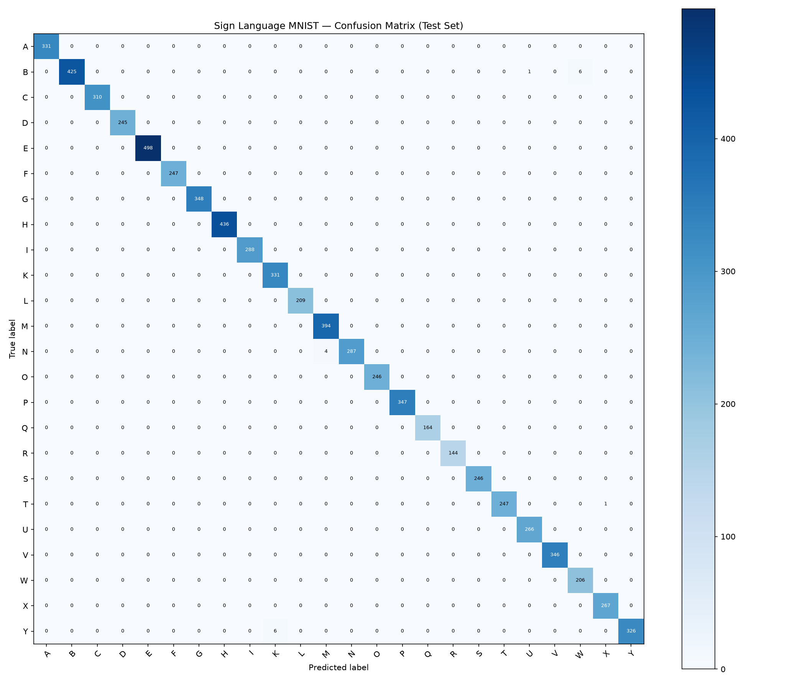

# Sign Language MNIST CNN — Classification Report

## Model
- Architecture: 3-block Conv2D CNN (32->64->128 channels, BN, ReLU, MaxPool) + FC head
- Checkpoint: `models\mnist_cnn_best.pt`
- Trained epoch: 10

## Test Set Results
- **Test Accuracy:** 0.9975 (99.75%)
- **Macro Precision:** 0.9973
- **Macro Recall:** 0.9978
- **Macro F1:** 0.9976

## Per-Class Report
```
              precision    recall  f1-score   support

           A       1.00      1.00      1.00       331
           B       1.00      0.98      0.99       432
           C       1.00      1.00      1.00       310
           D       1.00      1.00      1.00       245
           E       1.00      1.00      1.00       498
           F       1.00      1.00      1.00       247
           G       1.00      1.00      1.00       348
           H       1.00      1.00      1.00       436
           I       1.00      1.00      1.00       288
           K       0.98      1.00      0.99       331
           L       1.00      1.00      1.00       209
           M       0.99      1.00      0.99       394
           N       1.00      0.99      0.99       291
           O       1.00      1.00      1.00       246
           P       1.00      1.00      1.00       347
           Q       1.00      1.00      1.00       164
           R       1.00      1.00      1.00       144
           S       1.00      1.00      1.00       246
           T       1.00      1.00      1.00       248
           U       1.00      1.00      1.00       266
           V       1.00      1.00      1.00       346
           W       0.97      1.00      0.99       206
           X       1.00      1.00      1.00       267
           Y       1.00      0.98      0.99       332

    accuracy                           1.00      7172
   macro avg       1.00      1.00      1.00      7172
weighted avg       1.00      1.00      1.00      7172

```

## Most Confused Class Pairs
| True | Predicted | Count |
|------|-----------|-------|
| Y | K | 6 |
| B | W | 6 |
| N | M | 4 |
| T | X | 1 |
| B | U | 1 |

## Confusion Matrix

