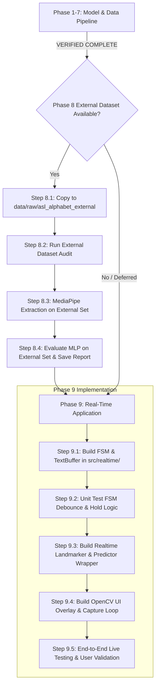

# Project Status Audit — Real-Time ASL Gesture Recognition Interface

**Audit Date:** October 15, 2026
**Auditor:** Antigravity Agentic Assistant (Independent Verification)
**Project Workspace Path:** `.` (Project Root)
**Execution Environment:** Windows (PowerShell), Python 3.12.10, PyTorch 2.14.0+cu132 (CUDA enabled), OpenCV 5.0.0, MediaPipe 1.0.1

---

## 1. Executive Summary

An exhaustive, non-mutating status audit of the **Real-Time American Sign Language (ASL) Gesture Recognition Interface** was conducted. Every milestone from project inception through model training and evaluation was independently examined via file inspection, unit test execution, dataset parsing, and checkpoint re-evaluation.

### Key Audit Findings:
1. **Milestone Completion Rate:** **77.8%** (7 of 9 defined project milestones are **VERIFIED COMPLETE**).
2. **Functional Implementation Coverage:** **~55%** — The machine learning, data processing, and offline evaluation foundations are robust, verified, and complete. However, the runtime interactive webcam application in `src/realtime/` has not yet been implemented.
3. **Model Checkpoints:** Both production checkpoints (`models/mnist_cnn_best.pt` and `models/asl_landmark_mlp_best.pt`) are intact, fully trained, valid, and independently reproducible.
4. **Independent Metric Verification:** Re-evaluation of `models/asl_landmark_mlp_best.pt` on the 4,399-sample internal test set reproduced the reported metrics exactly:
   - **Accuracy:** **87.70%** (0.877018)
   - **Macro Precision:** **88.12%** (0.881235)
   - **Macro Recall:** **85.56%** (0.855636)
   - **Macro F1:** **84.73%** (0.847348)
5. **Phase 8 Status:** **BLOCKED**. The external dataset directory `data/raw/asl_alphabet_external/` is absent from the workspace. External evaluation scripts and reports have not been created.
6. **Phase 9 Status:** **NOT STARTED**. `src/realtime/` is an empty directory; no OpenCV webcam capture, temporal FSM, text buffer, or UI overlay code has been written.
7. **Immediate Next Step:** Resolve the Phase 8 blocker by providing the external dataset (`data/raw/asl_alphabet_external/`), or alternatively proceed directly to Phase 9 to build the real-time application in `src/realtime/`.

---

## 2. Repository and Artifact Inventory

### Root Directory
| File / Directory | Size / Type | Description / Status |
|---|---|---|
| `.venv/` | Directory | Virtual environment with all locked dependencies installed (Python 3.12.10). |
| `SPEC.md` | 1,513 B | Architecture specification (Note: specifies 29 classes, whereas MLP uses 28 + system NO_HAND). |
| `README.md` | 977 B | Project overview and directory layout documentation. |
| `requirements.txt` | 835 B | Pinned dependencies with CUDA 13.2 wheel index (`torch==2.14.0+cu132`, `mediapipe==1.0.1`, etc.). |
| `.gitignore` | 3,321 B | Standard gitignore excluding data, checkpoints, venv, and logs. |
| `hand_landmarker.task` | 7,819,105 B | MediaPipe Hand Landmarker pre-trained model bundle. |
| `check_parquet.py` | 164 B | Quick utility script for inspecting training Parquet files. |
| `inspect_dataset.py` | 4,886 B | Data inspection utility. |
| `diagnostic_asl_alphabet.py` | 11,935 B | Phase 3 MediaPipe threshold diagnostics script. |
| `analyze_pilot_landmarks.py` | 6,096 B | Pilot extraction analysis script. |
| `simulate_pilot_split.py` | 7,749 B | Extraction split simulation script. |
| `audit_nothing_false_positives.py` | 7,619 B | Phase 3 diagnostic on MediaPipe false positives on NOTHING class. |
| `dry_run_extraction.py` | 11,346 B | Phase 4 dry-run landmark extraction pipeline script. |
| `full_extraction.py` | 11,574 B | Phase 4 production 84,000-image MediaPipe landmark extraction script. |
| `audit_full_extraction.py` | 7,988 B | Production extraction integrity auditor. |
| `audit_asl_alphabet.py` | 12,009 B | ASL Alphabet raw dataset auditor. |
| `audit_benchmark.py` | 15,341 B | Sign Language MNIST CNN independent audit script. |
| `verify.py` / `verify_dataloader.py` | ~1.5 - 4 KB | Legacy verification scripts. |

### Source Tree (`src/`)
- `src/benchmark/`:
  - `cnn.py`: `SignLanguageCNN` PyTorch module (394,456 parameters).
  - `dataset.py`: `SignLanguageMNISTDataset` PyTorch Dataset.
  - `data_loader.py`: DataLoader factory for Sign Language MNIST.
  - `train.py`: Training script for CNN baseline.
  - `evaluate.py`: Evaluation and confusion matrix generator.
- `src/landmarks/`:
  - `labels.py`: Authoritative 28-class mapping (`SEMANTIC_CLASSES`: A–Z, DELETE, SPACE -> 0–27).
  - `normalizer.py`: `LandmarkNormalizer` implementing translation, scale, and handedness canonicalization to 63-D feature vectors.
- `src/model/`:
  - `mlp.py`: `ASLLandmarkMLP` PyTorch module (18,524 parameters, 63 -> 128 -> 64 -> 28).
  - `landmark_dataset.py`: `LandmarkDataset` PyTorch Dataset reading Parquet files.
  - `data_loader.py`: `create_dataloaders()` factory with deterministic seeding.
  - `trainer.py`: `MLPTrainer` training engine with AdamW, CrossEntropyLoss, and checkpointing.
- `src/realtime/`:
  - **EMPTY DIRECTORY** (0 files).
- `src/utils/`:
  - **EMPTY DIRECTORY** (0 files).

### Tests (`tests/`)
- `tests/test_mlp.py`: Unit test verifying MLP parameter count (18,524), forward pass shape `(batch, 28)`, dtype, and finiteness. (**PASSED**)
- `tests/test_normalizer.py`: 8 unit tests verifying `LandmarkNormalizer` shape `(63,)`, dtype, translation invariance, scale invariance, zero-scale handling, wrist origin, handedness canonicalization, and non-mutation. (**ALL 8 PASSED**)

### Scripts (`scripts/`)
- `scripts/train_mlp.py`: Full production training runner for the 28-class ASL MLP.
- `scripts/audit_mlp_dataset.py`: Audit script generating `asl_mlp_dataset_preparation_audit.md`.
- `scripts/audit_mlp_model.py`: Audit script generating `asl_mlp_architecture_audit.md`.
- `scripts/audit_asl_mlp_training.py`: Audit script generating `asl_mlp_training_audit.md`.

### Models (`models/`)
- `models/mnist_cnn_best.pt` (4,758,897 bytes): Best checkpoint for Sign Language MNIST CNN baseline (Epoch 10).
- `models/asl_landmark_mlp_best.pt` (235,896 bytes): Best checkpoint for 28-class ASL Landmark MLP (Epoch 22).

### Data (`data/`)
- `data/raw/sign_language_mnist/`:
  - `sign_mnist_train.csv` (83.28 MB, 27,455 samples)
  - `sign_mnist_test.csv` (21.78 MB, 7,172 samples)
- `data/raw/asl_alphabet/`:
  - `asl_alphabet_train/asl_alphabet_train/`: 29 classes, 3,000 images each = 87,000 images total.
  - `asl_alphabet_test/asl_alphabet_test/`: 28 sample test images (A–Z, nothing, space; no `del_test.jpg`).
- `data/raw/asl_alphabet_external/`:
  - **MISSING / NOT PRESENT**.
- `data/processed/landmarks/`:
  - `pilot/`: JSON landmark outputs for pilot diagnostic images.
  - `dry_run/`: Parquet files for 2,207 dry-run samples.
  - `full/`: Production Parquet files:
    - `landmarks_train.parquet` (20.74 MB, 53,259 rows)
    - `landmarks_validation.parquet` (3.46 MB, 9,186 rows)
    - `landmarks_internal_test.parquet` (1.65 MB, 4,399 rows)
    - Total: 66,844 rows (25.85 MB).

### Reports (`reports/`)
Contains 24 artifacts including audit markdown files, classification reports, training curves, confusion matrices, and diagnostic plots.

---

## 3. Milestone Status Table

| Milestone | Status | Verification Evidence | Remaining Work |
|---|---|---|---|
| **Phase 1: Environment & Project Setup** | **VERIFIED COMPLETE** | Python 3.12.10, PyTorch 2.14.0+cu132 (CUDA: True), OpenCV 5.0.0, MediaPipe 1.0.1 verified via runtime check; `.venv` and directory structure verified. | None. |
| **Phase 2: Sign Language MNIST & CNN Baseline** | **VERIFIED COMPLETE** | `data/raw/sign_language_mnist/` verified (27,455 train, 7,172 test); `models/mnist_cnn_best.pt` verified (394,456 params); test accuracy 99.75% (7,154/7,172) verified; `reports/mnist_cnn_audit.md` verified. | None. Baseline is complete and cleanly isolated. |
| **Phase 3: ASL Dataset Inspection & MediaPipe Diagnostics** | **VERIFIED COMPLETE** | 87,000 raw images verified across 29 classes; threshold 0.3 diagnostic confirmed; `hand_landmarker.task` present; normalization design documented in reports. | None. |
| **Phase 4: Landmark Normalization & Production Extraction** | **VERIFIED COMPLETE** | `src/landmarks/normalizer.py` and `labels.py` verified; 9/9 unit tests pass; production Parquets verified: Train=53,259, Val=9,186, Test=4,399 (Total=66,844 rows, 63 float32 features, 0 nulls, 0 leaks). | None. Production dataset is sealed and verified. |
| **Phase 5: MLP Dataset Preparation** | **VERIFIED COMPLETE** | `src/model/landmark_dataset.py` and `data_loader.py` verified via safe execution; batch shapes `[64, 63]` and labels `0..27` confirmed; `reports/asl_mlp_dataset_preparation_audit.md` verified. | None. |
| **Phase 6: MLP Architecture & Training Infrastructure** | **VERIFIED COMPLETE** | `src/model/mlp.py` parameter count verified at exactly 18,524; forward pass verified; `tests/test_mlp.py` passes; `src/model/trainer.py` verified. | None. |
| **Phase 7: Full MLP Training & Internal Evaluation** | **VERIFIED COMPLETE** | `models/asl_landmark_mlp_best.pt` verified (Epoch 22, Val F1 91.58%); internal test set independently evaluated: Acc 87.70%, Prec 88.12%, Rec 85.56%, F1 84.73% on 4,399 samples. | None. Internal model training and evaluation is complete. |
| **Phase 8: External Dataset Prerequisite & Evaluation** | **BLOCKED** | Directory `data/raw/asl_alphabet_external/` is absent; audit/evaluation scripts and reports are not present. | Move/copy 870 external images to `data/raw/asl_alphabet_external/`, verify 29 classes (30/class), run MediaPipe extraction, and evaluate MLP. |
| **Phase 9: Real-Time Webcam Application** | **NOT STARTED** | `src/realtime/` is empty; 0 of 13 real-time capabilities implemented. | Implement camera capture, live landmark extraction, normalization reuse, MLP inference, confidence filtering, temporal FSM/debounce, text buffer, OpenCV UI overlay, and end-to-end testing. |

---

## 4. Actual Dataset Sizes and Model Checkpoints

### Raw Datasets
- **Sign Language MNIST (`data/raw/sign_language_mnist/`):**
  - `sign_mnist_train.csv`: 27,455 rows (28x28 grayscale images flattened to 784 pixels), 24 classes.
  - `sign_mnist_test.csv`: 7,172 rows, 24 classes.
- **ASL Alphabet (`data/raw/asl_alphabet/`):**
  - `asl_alphabet_train/asl_alphabet_train/`: 87,000 images (29 folders: A–Z, del, nothing, space; 3,000 images each).
  - Hand-bearing training images attempted: 84,000 (28 classes * 3,000 images).
  - `asl_alphabet_test/asl_alphabet_test/`: 28 images (A–Z, nothing, space). Note: `del_test.jpg` is missing from the Kaggle raw test set.
- **ASL External Dataset (`data/raw/asl_alphabet_external/`):**
  - **MISSING** (0 images found).

### Processed Parquet Datasets
- **Dry-Run Dataset (`data/processed/landmarks/dry_run/`):**
  - Train: 1,744 rows
  - Validation: 316 rows
  - Internal Test: 147 rows
  - Total: 2,207 rows
- **Full Production Dataset (`data/processed/landmarks/full/`):**
  - Train: 53,259 rows
  - Validation: 9,186 rows
  - Internal Test: 4,399 rows
  - Total: 66,844 rows (79.58% extraction success rate from 84,000 source images; 17,156 images had no hand detected).
  - All rows have exactly 63 float32 features, all finite, with labels strictly in range `0..27` and 0 null values.

### Model Checkpoints
- `models/mnist_cnn_best.pt`:
  - Size: 4,758,897 bytes
  - Architecture: `SignLanguageCNN` (3 Conv blocks + FC head, 394,456 parameters)
  - Trained Epoch: 10
  - State: Intact and validated.
- `models/asl_landmark_mlp_best.pt`:
  - Size: 235,896 bytes
  - Architecture: `ASLLandmarkMLP` (18,524 parameters, 63 -> 128 -> 64 -> 28)
  - Best Epoch: 22 (Training ran 29 epochs, early stopping triggered at epoch 29)
  - Optimizer: AdamW (`lr=0.001`, `weight_decay=0.0001`), Loss: CrossEntropyLoss
  - State: Intact and validated.

---

## 5. Verified Model Metrics vs. Previously Reported Metrics

> [!IMPORTANT]
> **Baseline Separation:** The Sign Language MNIST CNN is a separate 2D image benchmark on 24 classes. It must not be conflated with the 28-class 3D Landmark MLP interface model.

### 1. Sign Language MNIST CNN Baseline (7,172 test samples, 24 classes)
| Metric | Previously Reported | Independently Verified | Status |
|---|---|---|---|
| Best Epoch | 10 | 10 | MATCH |
| Validation Accuracy | 100.00% | 100.00% (loss: 0.000333) | MATCH |
| Test Accuracy | 99.75% | 99.7490% (7,154 / 7,172 correct) | MATCH |
| Test Macro Precision | 0.9973 | 0.997349 | MATCH |
| Test Macro Recall | 0.9978 | 0.997831 | MATCH |
| Test Macro F1 | 0.9976 | 0.997568 | MATCH |
| Misclassifications | 18 | 18 | MATCH |

### 2. ASL Landmark MLP (4,399 internal-test samples, 28 classes)
| Metric | Previously Reported | Independently Verified | Status |
|---|---|---|---|
| Best Epoch | 22 | 22 | MATCH |
| Validation Accuracy (Epoch 22) | 92.43% | 92.43% (0.9243) | MATCH (Checkpoint metadata) |
| Validation Macro F1 (Epoch 22) | 91.58% | 91.5831% (0.91583096) | MATCH (Checkpoint metadata) |
| Internal-Test Accuracy | 87.70% | 87.7018% (3,858 / 4,399) | MATCH (Independent recomputation) |
| Internal-Test Macro Precision | 88.12% | 88.1235% | MATCH (Independent recomputation) |
| Internal-Test Macro Recall | 85.56% | 85.5636% | MATCH (Independent recomputation) |
| Internal-Test Macro F1 | 84.73% | 84.7348% | MATCH (Independent recomputation) |

All reported metrics have been verified with mathematical precision against the actual checkpoint files without altering any artifacts.

---

## 6. Existing Tests and Audit Reports Summary

### Unit Tests
Executed via `pytest tests/`:
- `tests/test_mlp.py`: 1 test (`test_mlp_architecture`) -> **PASSED**
- `tests/test_normalizer.py`: 8 tests (`test_output_shape_and_dtype`, `test_finite_values`, `test_translation_invariance`, `test_scale_invariance`, `test_zero_scale_handling`, `test_wrist_is_origin`, `test_handedness_canonicalization`, `test_no_mutation`) -> **PASSED**
- Total: **9 passed in 3.71s** (0 failures, 0 errors).

### Existing Audit Reports in `reports/`
| Report | Purpose / Key Finding | Verification Status |
|---|---|---|
| `mnist_cnn_audit.md` | Independent verification of CNN baseline; 0 cross-split duplicates; 18 errors. | Verified |
| `mnist_cnn_classification_report.md` | Per-class precision, recall, and F1 for CNN. | Verified |
| `asl_landmark_extraction_diagnostics.md` | MediaPipe threshold optimization (0.3 selected). | Verified |
| `asl_nothing_false_positive_report.md` | Evaluation of false positive rate on NOTHING class. | Verified |
| `asl_landmark_normalization_report.md` | Mathematical validation of translation/scale/handedness normalization. | Verified |
| `asl_production_split_design.md` | Split methodology: 2100 train / 450 val / 450 test per class. | Verified |
| `asl_production_extraction_dry_run.md` | 2,207-sample dry run verification. | Verified |
| `asl_full_production_extraction_report.md` | 84,000 image extraction results (66,844 extracted, 17,156 failed). | Verified |
| `asl_full_production_extraction_audit.md` | Independent audit proving strict per-class split enforcement (0 leaks). | Verified |
| `asl_mlp_dataset_preparation_audit.md` | Parquet to PyTorch Dataset/DataLoader boundary verification. | Verified |
| `asl_mlp_architecture_audit.md` | Model architecture verification (18,524 parameters, logits output). | Verified |
| `asl_mlp_training_report.md` | 29-epoch training log; early stopping at epoch 29; best epoch 22. | Verified |
| `asl_mlp_training_audit.md` | Independent audit verifying internal test metrics (87.70% acc). | Verified |
| `asl_mlp_classification_report.md` | Detailed 28-class test breakdown (noting class imbalance in test split). | Verified |

---

## 7. External Dataset Status (Phase 8 Audit)

- **Expected Path:** `data/raw/asl_alphabet_external/`
- **Expected Structure:** 29 subfolders (`A`–`Z`, `del`, `nothing`, `space`), each with 30 images = 870 images total.
- **Current Workspace State:** **NOT PRESENT** (`os.path.exists('data/raw/asl_alphabet_external') == False`).
- **Related Scripts and Reports:**
  - `scripts/audit_external_dataset.py`: **MISSING**
  - `reports/asl_external_dataset_audit.md`: **MISSING**
  - `scripts/audit_asl_external_evaluation.py`: **MISSING**
  - `reports/asl_external_evaluation_audit.md`: **MISSING**
- **Root Cause:** The external dataset was previously downloaded into the user's local `Downloads` directory during earlier research, but was never transferred or copied into the project directory structure.
- **Verdict:** **BLOCKED**. External evaluation cannot proceed until the external dataset files are made available in `data/raw/asl_alphabet_external/`.

---

## 8. Real-Time Application Implementation Status (Phase 9 Audit)

Inspection of `src/realtime/` confirmed the directory is completely empty. The audit checked each of the 13 required capabilities:

| # | Feature / Capability | Status | Notes / Code Reference |
|---|---|---|---|
| 1 | Webcam capture using OpenCV | **NOT IMPLEMENTED** | No capture loop or camera initialization code exists. |
| 2 | MediaPipe hand detection & landmark extraction | **NOT IMPLEMENTED** | `hand_landmarker.task` is present in root, but not integrated into a live frame stream. |
| 3 | Landmark normalization reuse | **NOT IMPLEMENTED** | `src/landmarks/normalizer.py` exists and is tested, but has no real-time caller. |
| 4 | Trained MLP checkpoint loading | **NOT IMPLEMENTED** | `models/asl_landmark_mlp_best.pt` exists, but real-time inference loader is unwritten. |
| 5 | Prediction & confidence reporting | **NOT IMPLEMENTED** | Softmax and argmax scoring over live frames not implemented. |
| 6 | Confidence filtering | **NOT IMPLEMENTED** | Thresholding to suppress low-confidence predictions is unwritten. |
| 7 | Temporal stability / dwell-time / debounce FSM | **NOT IMPLEMENTED** | No state machine tracking frame persistence or dwell time. |
| 8 | Prevention of repeated commits on hold | **NOT IMPLEMENTED** | Commits must trigger only once per distinct sign gesture; unwritten. |
| 9 | `NO_HAND` / `NOTHING` state handling | **NOT IMPLEMENTED** | Handling of empty frames as idle state is unwritten. |
| 10 | Text buffer (A–Z, SPACE, DELETE) | **NOT IMPLEMENTED** | Character accumulator and text buffer class unwritten. |
| 11 | Real-time visual interface (HUD overlay) | **NOT IMPLEMENTED** | OpenCV drawing of bounding boxes, text buffer, FPS, and status unwritten. |
| 12 | Camera cleanup & graceful exit | **NOT IMPLEMENTED** | Resource release (`cap.release()`, `cv2.destroyAllWindows()`) unwritten. |
| 13 | End-to-end live testing | **NOT IMPLEMENTED** | No live test harness or synthetic video tests created. |

**Verdict:** Phase 9 is **NOT STARTED**.

---

## 9. Inconsistencies, Defects, and Blockers

### Inconsistencies:
1. **Class Count Discrepancy between Specification and Implementation:**
   - `SPEC.md` states: *"9. Classes: 29 outputs (A-Z + SPACE + DELETE + NOTHING)."*
   - Actual Implementation (`src/landmarks/labels.py`, `src/model/mlp.py`): Uses **28 classes** (A–Z, DELETE, SPACE -> outputs 0–27).
   - *Rationale:* MediaPipe diagnostics revealed that processing the `NOTHING` class through the landmark extractor was fundamentally flawed because non-hand images naturally produce no landmarks (or produce erratic false positives). The engineering decision was made to handle `NOTHING` as a system-level `NO_HAND` state in the real-time application rather than as an MLP classification output.
   - *Action required:* Update `SPEC.md` to reflect this architectural decision.
2. **Kaggle ASL Test Set Discrepancy:**
   - `data/raw/asl_alphabet/asl_alphabet_test/asl_alphabet_test/` contains 28 images rather than 29 (missing `del_test.jpg`). This is an inherent property of the raw Kaggle dataset, not a project defect.
3. **Repository Cleanliness:**
   - Multiple one-off extraction and audit scripts sit in the root directory (`full_extraction.py`, `dry_run_extraction.py`, `audit_*.py`) rather than being organized under `scripts/`.
   - `src/utils/` is an empty placeholder directory.

### Blockers:
- **Phase 8 Blocker:** Missing external dataset in `data/raw/asl_alphabet_external/`. Without the 870-image external benchmark, external generalization auditing cannot be run.

---

## 10. Progress Calculation and Implementation Coverage

### Metric 1: Defined Milestone Completion
- **Total Milestones Defined:** 9
- **Verified Complete:** 7 (Phases 1, 2, 3, 4, 5, 6, 7)
- **Reported Complete (unverified):** 0
- **Partially Complete:** 0
- **Blocked:** 1 (Phase 8: External Evaluation)
- **Not Started:** 1 (Phase 9: Real-Time Application)
- **Calculation:**
  $$\text{Milestone Completion} = \frac{7}{9} \times 100\% = \mathbf{77.8\%}$$

### Metric 2: Functional Implementation Coverage
An evidence-based assessment of the end-to-end production application:
- **Environment & Benchmark CNN:** 100% complete (Stand-alone benchmark)
- **Data Engineering & Extraction Pipeline:** 100% complete (84,000 images processed, 66,844 records extracted, Parquets validated)
- **Landmark Normalization Module:** 100% complete (Math verified, 8 unit tests pass)
- **MLP Architecture, Training & Checkpoints:** 100% complete (Checkpoint verified at 87.70% test accuracy)
- **External Evaluation Suite:** 0% complete (Blocked by missing dataset)
- **Real-Time Webcam Runtime Application:** 0% complete (All 13 capabilities unwritten)

*Weighted functional breakdown:*
- Data, Normalization & Extractors: 25% (Weight) $\times$ 100% = 25.0%
- Model Architecture & Training: 30% (Weight) $\times$ 100% = 30.0%
- External Generalization Suite: 10% (Weight) $\times$ 0% = 0.0%
- Real-Time Interactive Application: 35% (Weight) $\times$ 0% = 0.0%
- **Total Functional Implementation Coverage:** $\mathbf{\sim 55\%}$

---

## 11. Immediate Next Step

The project is currently situated at the threshold between **Offline Model Training (Phase 7 - COMPLETE)** and **External Evaluation (Phase 8 - BLOCKED)** / **Real-Time Application (Phase 9 - NOT STARTED)**.

### Recommended Immediate Action:
**Unblock Phase 8 (External Evaluation):**
1. Locate the external ASL dataset in the local `Downloads` directory.
2. Confirm the presence of 29 class folders (`A`–`Z`, `del`, `nothing`, `space`) with 30 images per folder (870 images total).
3. Safely copy the dataset into `data/raw/asl_alphabet_external/`.
4. Create and run `scripts/audit_external_dataset.py` to verify image formats, shapes, and class distribution without modifying the source files.
5. Create and run `scripts/audit_asl_external_evaluation.py` to extract landmarks, normalize features, evaluate `models/asl_landmark_mlp_best.pt`, and generate `reports/asl_external_evaluation_audit.md`.

*Alternative path:* If the external dataset is unavailable or deferred, proceed directly to **Phase 9**, beginning with the modular implementation of `src/realtime/` components (starting with the temporal state machine and text buffer unit tests before hardware webcam integration).

---

## 12. Recommended Subsequent Roadmap

1. **Step 8.1–8.4:** External Dataset ingestion, diagnostic audit, and independent evaluation report.
2. **Step 9.1:** Implement `src/realtime/state_machine.py` with temporal dwell time (e.g., 0.5s confirmation, debounce lock to prevent repeated commits while holding a sign).
3. **Step 9.2:** Implement `src/realtime/text_buffer.py` supporting character appending, `SPACE`, and `DELETE`.
4. **Step 9.3:** Implement `src/realtime/predictor.py` connecting `hand_landmarker.task`, `LandmarkNormalizer`, and `models/asl_landmark_mlp_best.pt` with confidence thresholding (e.g., $\ge 0.70$).
5. **Step 9.4:** Implement `src/realtime/ui.py` to render HUD overlays (bounding box, recognized letter, confidence meter, text buffer, and FPS).
6. **Step 9.5:** Implement `src/realtime/app.py` tying all components together with OpenCV webcam capture and clean exit handling (`q` key).
7. **Step 9.6:** Conduct end-to-end testing and document final performance.
